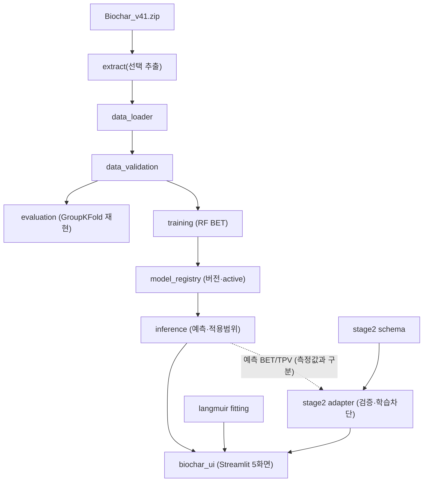

# 바이오차 물성·흡착성능 2-Stage 예측 프로그램 설계

> **개정 이력**
> - v1 (이전): 범용 열분해 생성물·고체 특성·촉매 성능 예측 설계. `pyrolysis/*` 공통 프레임워크
>   (contracts·config·io·validation·preprocessing·models·splitting·training·evaluation·
>   analysis·artifacts·inference·ranking·cli·ui)와 Streamlit 앱을 구현했다.
> - **v2 (현재)**: Stage 1 BET/TPV, Stage 2 qe 중심으로 개정. v1 공통 프레임워크를 **최대한
>   재사용**하고, 바이오차 전용 계층(`pyrolysis/biochar_stage1`, `biochar_stage2`, `biochar_ui`)을
>   추가한다. 연계 예측 구조는 최종 목표로 문서화하되 검증 전에는 작동하는 성능 예측으로 표시하지 않는다.

## 1. 설계 결정

| 항목 | 결정 |
|---|---|
| 개발·학습 환경 | Windows, Python 3.12, CPU. 로컬 가상환경 `.venv` |
| 웹앱 | Streamlit 단일 앱, 한국어 화면 + 필요한 영어 기술 용어 |
| 학습 실행 | 명령행에서 동일 Python 함수 호출(`python -m pyrolysis.biochar_stage1.cli`) |
| 웹의 역할 | 저장된 활성 모델을 이용한 예측·조건 비교. 학습·모델 업로드 없음 |
| 데이터 보관 | 원본 zip·추출본·연구 기록은 로컬 보관(`data/`, `runs/` Git 제외) |
| 데이터 반영 | v41 zip에서 **필요한 파일만 선택 추출**, 원본 미변경 |
| 예측 구조 | Stage 1·Stage 2를 분리. 공통 계약을 재사용하되 바이오차 전용 모듈로 구현 |
| 모델 저장 | joblib + metadata.json, 버전 디렉터리와 active 포인터로 관리 |
| 결과 표시 | 공학 분석 스타일 5개 화면. 조건 비교 CSV 다운로드 제공 |

Python·Streamlit 내부에서 화면과 계산 계층을 분리한다. 계산 모듈(`pyrolysis/biochar_stage1/*`,
`biochar_stage2/*`)은 Streamlit을 import하지 않는다. 별도 React·FastAPI·DB·작업 큐는 넣지 않는다.

## 2. 기존 컴포넌트 재사용 방침

v2는 v1 프레임워크를 삭제하지 않고 재사용·보존한다.

| v1 컴포넌트 | v2에서의 역할 |
|---|---|
| `pyrolysis/contracts.py` | Pydantic 입력/출력/묶음 계약. Stage 2 스키마 설계의 참고 모델 |
| `pyrolysis/artifacts.py` | joblib 저장·해시·환경 검사 방식. Stage 1 모델 저장 설계의 근거 |
| `pyrolysis/splitting.py` | 출처 그룹 분할·누설 방지 사고방식(GroupKFold 재현의 근거) |
| `pyrolysis/preprocessing.py`, `models.py` | 파이프라인·모델 구성 패턴 참고 |
| `pyrolysis/ui/`, `streamlit_app.py` | 기존 범용 demo 앱(보존). 바이오차 앱은 별도 진입점 |
| `pyrolysis/cli.py` 등 | 공통 CLI 패턴 참고 |
| `tests/` (기존 24개 파일) | 회귀 방지 기준. 삭제·조작하지 않음 |

기존 범용 모듈·앱·테스트는 **그대로 보존**한다. 바이오차 전용 기능은 신규 패키지로 추가하여
구 코드와 충돌하지 않게 한다.

## 3. 전체 구조

점선(Stage 1 → Stage 2)은 **연계 구조의 목표**이며 Phase 1에서는 측정값/예측값 구분과 오차 전파를
고려한 **인터페이스만** 제공한다. 실제 Stage 2 학습·연계 예측은 수행하지 않는다.

## 4. 모듈 구성

### 4.1 Stage 1 — `pyrolysis/biochar_stage1/`

| 모듈 | 책임 |
|---|---|
| `features.py` | 10개 입력 계약(순서·단위·분석 basis), 출력(BET m²/g), 적용 범위 선언 |
| `extract.py` | v41 zip에서 필요한 파일만 선택 추출(원본 미변경), eval37/merge30 경로 해석 |
| `data_loader.py` | base(182)·extra(99) 로드, 데이터셋 버전 해시. 학습과 분리된 읽기 |
| `data_validation.py` | 컬럼·단위·결측·출처 그룹·학습 적격성·조성 합계 점검(값 미생성) |
| `evaluation.py` | eval37 GroupKFold 재현(5-fold, seed 0/1/2), 누설 검사, 참고 수치 비교 |
| `training.py` | 최종 RF BET 학습, 버전 저장, 전체 메타데이터 기록 |
| `inference.py` | 저장 모델 로드·예측(순서 고정), 입력 정상성·적용 범위 판정(차단 vs 주의 분리) |
| `model_registry.py` | 모델 버전 나열·활성 포인터 관리(앱은 활성 모델만 로드, 재학습 없음) |
| `cli.py` | `train` / `evaluate` / `audit` 하위 명령 |

### 4.2 Stage 2 — `pyrolysis/biochar_stage2/`

| 모듈 | 책임 |
|---|---|
| `schema.py` | 향후 수용할 입력 스키마(필드·단위·학습 필수 여부), qe 값 종류 구분 상수 |
| `adapter.py` | 프레임 검증, 학습 승인 행 판정(미검증 차단), Stage 1 결합 입력(측정/예측 구분) |
| `langmuir.py` | 실측 등온흡착 Langmuir 비선형 피팅, 식별 불가·데이터 부족 시 거부 |

### 4.3 UI — `pyrolysis/biochar_ui/`

| 모듈 | 책임 |
|---|---|
| `pages.py` | 5개 화면(Overview/Prediction/Condition Comparison/Adsorption/Validation), 모델 캐시 로드 |
| (진입점) `biochar_app.py` | `streamlit run biochar_app.py`. 화면만 호출, 계산은 패키지 함수 |

계산 모듈은 Streamlit을 import하지 않는다. 학습은 CLI로만 수행하고 앱은 활성 모델만 로드한다.

## 5. Stage 1 데이터·모델 설계

### 5.1 데이터 반영 규칙

v41 패키지의 모든 CSV가 학습에 적합한 것은 아니다. 다음을 구분한다.

| 구분 | 예시 파일 | 처리 |
|---|---|---|
| 기준 평가 자료 | `eval37/base.csv` (182행) | GroupKFold 평가·학습에 사용 |
| 추가 학습 후보 | `eval37/extra_leng.csv` (99행) | 누설 제거 후 학습에 병합. 평가 폴드 무조건 병합 금지 |
| 원자료·학습 풀 | `merge30/Cumulative_observations_v30.csv`, `*_train_pool.csv` | 점검·참고. 선별 전 학습 금지 |
| 제외·별도 관리 | `merge30/Excluded_or_separate.csv` | 학습 제외 |
| 미검증 Stage 2 후보 | Stage2 qe 계열 | 평형 검증 전 학습 금지 |
| 기존 검증 결과 | `eval37/summary.csv`, `metrics.csv` | 재현 비교 기준. 최종 독립 검증으로 과장 금지 |

`eval37`의 기존 결과는 **독립적 최종 성능 검증으로 과장하지 않는다.** 먼저 GroupKFold를 재현하고,
학습용 최종 모델의 저장·활성화는 **별도 단계**로 관리한다.

### 5.2 입력 계약 (features.py)

10개 입력의 순서·단위·분석 basis를 고정한다(§requirements REQ-02). 원소분석은 daf, 공업분석은
dry basis. 합계를 100으로 정규화하지 않는다. 적용 범위는 Leng2022 비활성화 열분해로 선언한다.

### 5.3 평가 재현 (evaluation.py)

eval37/run.py의 고정 RF 외부 GroupKFold OOF 평가를 재현한다. 로컬 sklearn이
`GroupKFold(shuffle=)`를 지원하지 않으면 그룹 셔플 분할을 자체 구현으로 재현하고, 그 차이와
라이브러리 버전 차이를 보고한다. 내부 GridSearch 튜닝은 재현 범위에서 제외하고 지시서가 요구한
고정 RF 기준모델만 평가한다. 평가 점수는 **탐색적 일반화 검증**이며 최종 배포 모델의 독립 검증이 아니다.

### 5.4 모델 저장 (training.py / model_registry.py)

버전 디렉터리 `deployment/stage1_models/<version>/{model.joblib, metadata.json}`와 `active.json`
포인터로 관리한다. 메타데이터는 데이터셋 해시, 입력·순서·단위·basis, 하이퍼파라미터, 전처리,
학습 관측 수·출처 그룹, 학습 시각, 교차검증 설정·결과, 라이브러리 버전, 적용 범위·미검증 사항을
포함한다. 앱은 활성 모델만 로드하며 재학습하지 않는다.

### 5.5 적용 범위 검증 (inference.py)

입력 정상성(단위·음수·비정상 조성)은 오류로, 학습 범위 이탈은 주의(TRAINING_RANGE_EXCEEDED)로
분리한다. 모든 값이 범위 안이어도 조합 검증을 보장하지 않는다는 주의(WITHIN_RANGE_NOT_GUARANTEED)를
남긴다. 검증되지 않은 신뢰도 백분율은 만들지 않는다.

## 6. Stage 2 확장 인터페이스 설계

### 6.1 스키마 (schema.py)

§requirements REQ-08의 필드를 정의한다. 모든 필드가 준비됐다는 뜻은 아니다. qe 값의 종류를
`measured / langmuir_qmax / model_predicted / reported_unverified`로 구분해 관리한다.

### 6.2 학습 차단 (adapter.py)

학습 승인 조건: `measurement_status == "measured"` AND 평형 검증됨 AND measured_qe 수치 AND
필수 필드 존재. 승인 행이 부족하면 `TrainingBlockedError`로 학습을 차단한다. 미검증 데이터로 Stage 2
모델을 학습하지 않는다.

### 6.3 Stage 1 ↔ Stage 2 연계 (adapter.py)

`Stage1LinkInput`으로 BET/TPV 값의 출처(measured vs stage1_predicted)와 불확실성을 함께 전달한다.
예측값을 쓰면 measured_* 필드에 넣지 않고 출처를 명시한다. Phase 1은 **결합 구조만** 제공하며 Stage 2
모델 학습·연계 예측은 하지 않는다. 연계 예측은 최종 목표로 문서화한다.

### 6.4 Langmuir fitting (langmuir.py)

`qe = qmax·KL·Ce / (1 + KL·Ce)`를 비선형 최소제곱으로 피팅한다. 최소 3개의 서로 다른 평형점이
필요하며, 데이터 부족·음수·식별 불가 시 수치를 만들지 않고 사유를 반환한다
(INSUFFICIENT_POINTS / NON_POSITIVE / DEGENERATE_CE / FIT_FAILED / UNIDENTIFIABLE). 결과에는 이
분석이 Stage 2 머신러닝 예측과 별개임을 명시한다.

## 7. 화면 설계 (biochar_ui/pages.py)

| 화면 | 구성 |
|---|---|
| A. Overview | 연구 목적, 모델 연결 상태, Stage 1/2 구현 상태, 데이터셋 버전 |
| B. Pyrolysis Prediction | 원료 원소·공업분석, 열분해 조건 입력 → BET 예측 + 적용 범위 판정 + 모델 버전·검증 오차 |
| C. Condition Comparison | 동일 원료에서 온도 변화 비교표, 예측 곡선(모델 응답 표시), CSV 다운로드 |
| D. Adsorption Analysis | Stage 2 미확정 표시, 입력 스키마, 실측 Langmuir fitting |
| E. Data & Model Validation | 학습 데이터 수·출처 그룹·결측 비율·포함/제외, GroupKFold 지표, 적용 범위·한계 |

조건 비교 곡선은 모델 예측 응답임을 표시하고 실측 곡선처럼 표현하지 않는다. 검증 오차를 개별 예측
신뢰구간으로 표현하지 않는다. 읽기 전용 모델은 `st.cache_resource`로 재사용하고, 사용자 입력·결과는
세션에만 둔다.

## 8. 파일 배치와 Git 관리

| 경로 | 내용 | Git |
|---|---|---|
| `.kiro/specs/pyrolysis-predictor/` | 요구사항·설계·작업 문서 | 포함 |
| `pyrolysis/`(기존) + `biochar_stage1/`·`biochar_stage2/`·`biochar_ui/` | 공통·바이오차 패키지 | 포함 |
| `biochar_app.py`, `streamlit_app.py` | 바이오차 앱·기존 범용 앱 진입점 | 포함 |
| `Biochar_Complete_Project_v41.zip` | 원본 데이터 패키지(선택 추출 원천) | 포함 |
| `data/`, `runs/`, `configs/local/`, `templates/local/` | 추출본·연구 기록·로컬 설정 | 제외 |
| `deployment/stage1_models/<version>/` + `active.json` | Stage 1 모델·버전·활성 포인터 | 포함 |
| `tests/` | 기존 + 바이오차 테스트 | 포함 |
| `docs/biochar_data_status.md` | v5 데이터 조사 기록(이력 보존) | 포함 |

`data/`는 Git에서 제외되므로 로더가 커밋된 zip에서 **자동 재추출**한다. 원본 zip·플래그는 변경하지 않는다.

## 9. 기존 데이터 조사 이력과의 관계 (중요)

`docs/biochar_data_status.md`, `pyrolysis/biochar_data.py`, `pyrolysis/biochar_stage1_eval.py`는
**이전 데이터 버전**(`Biochar_Stage1_Expansion_v5.zip` → verified_v5, BET 47 / Pore 42, Stage2 qe
7177행)을 집계·탐색 평가한 산출물이다. 현재 Phase 1 학습·예측은 **v41 패키지(eval37 base 182 +
extra 99)** 를 사용한다. 두 데이터는 서로 다른 버전이므로 혼동하지 않는다.

- **현재 기준(Phase 1 구현)**: v41 / eval37 → `pyrolysis/biochar_stage1/*`.
- **이력 보존(참고)**: v5 / verified_v5 → `biochar_data.py`, `biochar_stage1_eval.py`,
  `docs/biochar_data_status.md`. 삭제하지 않고 조사 기록으로 보존한다.

v5 조사의 결론(원료 범주의 논문 종속성, Pore 일반화 한계 등)은 Stage 1 입력 개선·TPV 활성화 판단의
참고 자료로 유지한다.

## 10. 검증 계획과 요구사항 대응

| 검증 내용 | 확인 방법 | 대응 요구사항 |
|---|---|---|
| 저장·재로드 결정성 | 재로드 예측 == 메모리 예측 | REQ-06, 성공기준3 |
| 입력 스키마·단위 유지 | features 계약 고정 검사 | REQ-02, 성공기준4 |
| GroupKFold 누설 없음 | 학습/검증 그룹 disjoint, 누설 플래그 | REQ-05, 성공기준5 |
| Stage 1 독립 동작 | Stage 2 없이 학습·예측 | REQ-03/09, 성공기준6 |
| Stage 2 미검증 학습 차단 | 미검증 프레임 → TrainingBlockedError | REQ-08, 성공기준7 |
| 조건 비교·CSV | 표·곡선·다운로드 버튼 | REQ-11, 성공기준8 |
| Langmuir 피팅/거부 | 파라미터 복원, 부족·식별불가 거부 | REQ-10 |
| 적용 범위 판정 | 범위 이탈 주의, 비정상 조성 오류 | REQ-07 |
| 앱 실행 | AppTest 5화면 예외 없음 | REQ-11, 성공기준1·2 |
| 기존 회귀 없음 | 전체 pytest 통과 | 성공기준9 |

가상·탐색 평가 수치를 실제 연구 성과로 보고하지 않는다. 기존 eval37 점수를 새 모델의 독립 검증처럼
표시하지 않는다.

## 11. 기술 참고 문서

- [S1 — scikit-learn 모델 저장·환경 호환성](https://scikit-learn.org/stable/model_persistence.html)
- [S2 — scikit-learn 교차검증·그룹 분할](https://scikit-learn.org/stable/modules/cross_validation.html)
- [S3 — scipy.optimize.curve_fit](https://docs.scipy.org/doc/scipy/reference/generated/scipy.optimize.curve_fit.html)
- [S4 — Streamlit 캐시](https://docs.streamlit.io/develop/concepts/architecture/caching)
- [S5 — Streamlit Session State](https://docs.streamlit.io/develop/concepts/architecture/session-state)
- [S6 — Kiro Specs](https://kiro.dev/docs/specs/)
