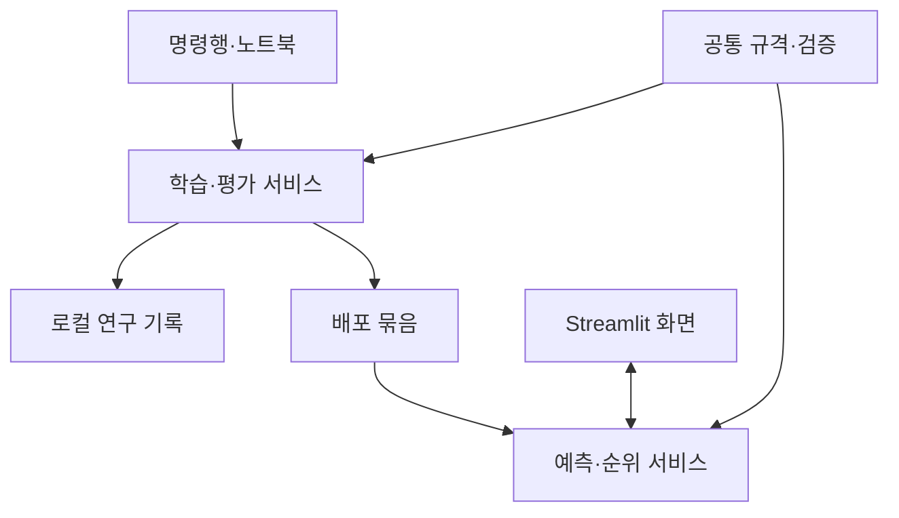

# 폐기물 열분해 생성물·고체 특성·촉매 성능 예측 프로그램 설계

## 1. 설계 결정

| 항목 | 결정 |
|---|---|
| 개발·학습 환경 | Windows, Python 3.12, CPU 실행 |
| 개발 도구·저장소 | Kiro, 신규 비공개 GitHub 저장소 |
| 웹앱 | Streamlit 단일 앱, 한국어 화면과 필요한 영어 기술 용어 |
| 배포 | 무료 Streamlit Community Cloud, 앱은 공개하여 로그인 없이 이용 |
| 학습 실행 | 명령행과 Jupyter Notebook에서 동일한 Python 함수를 호출 |
| 웹의 역할 | 저장된 배포 묶음을 이용한 예측·비교. 학습 기능과 모델 업로드 기능은 제공하지 않음 |
| 데이터 보관 | 원본·정리된 학습 자료와 상세 연구 기록은 학습 PC에 보관 |
| 서버 전달 | 코드, 모델·전처리, 입력·출력 규격, 적용 범위와 검증 요약만 전달 |
| 입력 방식 | 설정에서 생성한 표준 Excel·CSV 양식. 웹에서 열을 임의로 연결하는 화면은 없음 |
| 예측 구조 | 지표별 모델을 공통 인터페이스로 실행하는 구성을 먼저 구현. 공동 출력·연계 구조는 데이터 확인 후 필요할 때 확장 |
| 사용자 기록 | 현재 요청의 입력·결과만 세션 메모리에서 처리. 데이터베이스·누적 예측 이력 없음 |
| 결과 표시 | 여러 지표의 결과표, 선택한 수치형 지표 하나의 후보 순위. 결과 다운로드 없음 |

기체·액체의 등록 성분 조성, 고체 작용기의 수치·검출 분류, 기공 요약 지표, 촉매 성능을 같은 실행 틀로 다룬다. 실제 변수명·성분 목록·단위·반응·검출 기준·허용 오차는 데이터 확보 후 설정한다. 빈 설정에서 실제 지표를 추정하거나 예시 모델로 자동 대체하지 않는다.

Python·Streamlit 내부에서 화면과 계산 계층을 분리한다. 별도 React 프런트엔드, FastAPI 서버, 데이터베이스, 작업 큐는 초기 구성에 넣지 않는다. 이후 화면이나 실행 환경이 바뀌어도 공통 예측 모듈을 재사용한다.

## 2. 전체 구조



화면에는 자료 읽기·입력 위젯·결과 표시만 둔다. 전처리 학습, 예측, 입력·출력 검증, 순위 계산은 공통 패키지에서 수행한다. 노트북에 별도의 학습 알고리즘이나 전처리 함수를 복사하지 않는다.

### 2.1 주요 모듈

| 모듈 | 책임 |
|---|---|
| `pyrolysis/contracts.py` | 설정·입력·출력·배포 묶음의 자료형과 구조 검증 |
| `pyrolysis/config.py` | YAML 설정 읽기, 준비 상태 확인, 입력 규격 생성 |
| `pyrolysis/io.py` | 학습 자료와 예측 파일 읽기, 표준 양식 생성, 행·열 위치 보존 |
| `pyrolysis/validation.py` | 결측·범주·물리적 제약·학습 범위·출력 제약 검증 |
| `pyrolysis/preprocessing.py` | 모델별 전처리 Pipeline과 목표 변환 구성 |
| `pyrolysis/models.py` | 회귀·분류 모델 후보와 예측 어댑터 등록 |
| `pyrolysis/splitting.py` | 독립 그룹을 유지하는 분할 계획 생성·검사 |
| `pyrolysis/training.py` | 대상별 학습, 내부 비교·선정, 최종 재학습 |
| `pyrolysis/evaluation.py` | 독립 평가, 기준 모델 비교, 대상별 평가 가능 여부 |
| `pyrolysis/analysis.py` | 변수 기여도와 로컬 연구용 표·그림 생성 |
| `pyrolysis/artifacts.py` | 배포 묶음 생성·검증·읽기, 파일 무결성과 환경 호환성 확인 |
| `pyrolysis/inference.py` | 전체 활성 지표의 예측과 요청 단위 완료·실패 처리 |
| `pyrolysis/ranking.py` | 수치형 지표 하나의 순위 계산 |
| `pyrolysis/cli.py` | 공통 서비스의 명령행 진입점 |
| `pyrolysis/ui/` | 한국어 입력·결과·오류 화면과 세션 상태 관리 |
| `streamlit_app.py` | 앱 초기화, 배포 묶음 읽기, 화면 호출 |

계산 모듈은 Streamlit을 import하지 않는다. 학습 서비스는 웹 화면에서 호출하지 않으며 예측 서비스는 학습 데이터 경로를 요구하지 않는다.

### 2.2 공통 서비스 인터페이스

```text
load_problem(path) -> ProblemSpec
audit_dataset(data, problem) -> AuditReport
run_training(data, problem, training_config) -> RunReport
export_bundle(run_dir, release_config, output_dir) -> BundleManifest
load_bundle(active_file) -> LoadedBundle
parse_prediction_file(file_bytes, filename, input_schema) -> CandidateTable
predict_all(bundle, candidates) -> PredictionBatch
rank_candidates(batch, target_id, direction, target_value=None) -> RankingResult
```

명령행·노트북·웹이 필요한 인터페이스를 공유한다. 단일 예측도 후보 한 행의 `CandidateTable`로 바꾸어 일괄 예측과 같은 함수를 통과시킨다.

## 3. 프로젝트와 의존성

### 3.1 파일 배치

| 경로 | 내용 | Git 관리 |
|---|---|---|
| `.kiro/specs/pyrolysis-predictor/` | 요구사항·설계·구현 작업 문서 | 포함 |
| `pyrolysis/`, `streamlit_app.py` | 공통 패키지와 웹 진입점 | 포함 |
| `pyproject.toml` | 패키지 설치와 테스트 설정 | 포함 |
| `requirements.txt` | 웹·공통 계산에 필요한 고정 버전 의존성 | 포함 |
| `requirements-dev.txt` | 공통 의존성에 Jupyter·테스트 도구 추가 | 포함 |
| `configs/*.template.yaml` | 개인정보·실측값이 없는 설정 원형 | 포함 |
| `configs/local/` | 실제 학습 파일 경로와 연구별 설정 | 제외 |
| `configs/runtime.yaml` | 앱 운영 모드와 처리 한도 | 포함 |
| `.streamlit/config.toml` | 화면·업로드·내보내기 설정 | 포함 |
| `.streamlit/secrets.toml` | 필요한 경우의 운영 비밀값 | 제외 |
| `notebooks/` | 점검·학습·평가 노트북. 셀 출력 제거 후 저장 | 포함 |
| `data/`, `runs/`, `templates/local/` | 원본·정리 자료, 상세 연구 기록, 실제 입력 양식 | 제외 |
| `deployment/bundles/<bundle_id>/` | 선정한 모델과 배포용 정보 | 포함 |
| `deployment/active.json` | 현재 사용하는 묶음과 manifest 해시 | 포함 |
| `tests/fixtures/` | 연구 데이터와 구분되는 가상 검증 자료 | 포함 |
| `docs/` | 설치·데이터 준비·실행·배포 안내 | 포함 |

모든 경로는 저장소 루트 또는 설정 파일 위치를 기준으로 해석하고 `pathlib.Path`를 사용한다. Windows 절대 경로를 코드나 배포 묶음에 넣지 않는다. GitHub에는 비공개 저장소라도 학습 자료를 올리지 않는다.

### 3.2 사용 라이브러리

- 화면: Streamlit. 현재 확인한 1.64 API의 데이터 내보내기 차단 설정을 사용한다.
- 자료 처리: pandas, NumPy, openpyxl. 표준 Excel 형식은 `.xlsx`로 지정한다.
- 규격: Pydantic, PyYAML의 안전한 로더. YAML에서 임의 Python 객체를 생성하지 않는다.
- 모델: scikit-learn, XGBoost. CPU 실행을 기준으로 한다.
- 모델 저장: joblib. 신뢰할 수 있는 운영자 산출물만 읽는다.
- 연구 그림: Matplotlib. 초기 웹 결과는 표 중심으로 구성한다.
- 개발·검증: JupyterLab, ipykernel, pytest, Streamlit의 AppTest.

구현 시작 시 Windows와 Linux에서 함께 설치되는 정확한 버전을 확인하고 직접·간접 의존성을 고정한다. 학습과 배포에서 모델 관련 패키지 버전을 동일하게 사용한다. `latest`에 의존하거나 Windows 전용 패키지가 포함된 전체 환경 목록을 그대로 Cloud에 전달하지 않는다. 모델 저장 환경과 배포 환경의 호환성을 실제 다시 읽기·예측으로 검사한다.[S3]

## 4. 설정과 데이터 계약

### 4.1 설정 파일의 역할

| 설정 | 역할 |
|---|---|
| `problem.yaml` | 원료·공정·반응 범위, 입력 변수, 예측 대상, 측정 기준, 물리적 제약 |
| `dataset.yaml` | 학습 파일·시트, 원본 열 매핑, 출처·시료·측정 식별자, 단위 변환·결측 처리 정책 |
| `training.yaml` | 분할 계획, 후보 모델, 조정 범위, 선정 기준, 난수 설정 |
| `release.yaml` | 실제 활성화할 대상, 제공하지 않는 사유, 최종 재학습·배포 설정 |
| `runtime.yaml` | 운영 모드, 배포 묶음 위치, 파일·행·열·동시 계산 등의 처리 한도 |

실제 설정은 `configs/local/`에 두고 배포 시 필요한 규격만 배포 묶음으로 내보낸다. 실제 변수명을 코드의 상수나 화면 로직에 직접 넣지 않는다.

자료가 없는 초기 문제 설정은 다음처럼 빈 상태를 명시한다. 이를 실제 예측 가능한 설정으로 취급하지 않는다.

```yaml
schema_version: 1
problem_id: null
status: draft
inputs: []
targets: []
composition_groups: []
```

`draft`는 파일 구조를 점검할 수 있는 상태다. 실제 학습에는 필요한 정의가 채워진 대상이 있어야 하며, 실제 웹 예측에는 검증을 마친 활성 대상이 있어야 한다.

### 4.2 입력 변수 `InputSpec`

| 필드 | 의미 |
|---|---|
| `id`, `label_ko`, `description` | 내부 식별자, 한국어 이름, 의미 |
| `role` | `feedstock`, `preparation`, `reaction_test` 중 해당 역할 |
| `dtype` | 정수·실수·범주 등 허용 형식 |
| `unit`, `basis` | 단위와 산출 기준. 무차원 여부도 명시 |
| `required`, `missing_policy` | 필수 여부와 학습 시 확정한 결측 처리 |
| `allowed_categories` | 범주형 입력의 표준 값과 표시 이름 |
| `physical_constraints` | 물리적 허용 범위·조건식. 학습 최솟값·최댓값과 별개 |
| `display_order` | 표준 양식과 화면의 표시 순서 |

선택 입력으로 허용한 결측만 저장된 처리 규칙을 적용한다. 필수 값의 누락과 해석 오류는 학습된 대체값이 있더라도 예측 요청 오류로 처리한다. 근거 없는 기본값을 입력 위젯에 미리 채우지 않는다.

### 4.3 예측 대상 `TargetSpec`

| 필드 | 의미 |
|---|---|
| `id`, `label_ko`, `family` | 내부 식별자·이름과 기체·액체·작용기·기공·성능 범주 |
| `task` | `regression` 또는 작용기별 `binary_classification` |
| `definition`, `unit`, `basis` | 수치·분류의 의미, 단위, 조성의 분모 등 |
| `measurement` | 분석 방법, 전처리·피크 분리·산출 기준, 정량·상대값 구분 |
| `input_ids` | 해당 모델이 실제로 사용하는 사전 입력 목록 |
| `label_mapping`, `positive_label` | 분류 정답의 원본 표기와 내부 0·1 대응 |
| `detection_rule` | 검출 표지의 정의. 수치로부터 변환하면 그 근거·기준 |
| `reaction_context` | 촉매 반응과 지표 산출 조건. 다른 대상에는 해당 없음 |
| `output_constraints` | 비음수·비율·유한성 등의 제약과 정한 수치 허용 오차 |
| `display_precision` | 화면 표시 정밀도. 예측 계산·순위 계산값은 바꾸지 않음 |

서로 다른 측정 기준은 다른 대상 또는 별도 문제 설정으로 구분한다. 기준을 입력 특성으로 다루는 방법을 택한다면 같은 목표로 비교할 수 있는 근거를 먼저 설정에 기록한다. 이름이 비슷하다는 이유로 자동 통합하지 않는다.

### 4.4 조성과 묶음의 규격

`CompositionGroupSpec`에는 상, 성분 목록, 조성 기준·분모, 전체·부분 조성 여부, 성분군 중복 여부와 합 제약을 기록한다. 전체가 포괄되고 상호 배타적인 경우에만 지정된 합 제약을 검사한다. 일부 성분만 활성화되었다면 그 범위의 개별 값만 보여주고 전체 조성 합이 검증된 것처럼 표시하지 않는다.

`InputSchema`는 활성 대상의 외부 입력 합집합으로 생성한다. 대상마다 입력의 필수 여부나 제약이 다르면 모든 활성 대상에서 성립하는 규칙을 확인한다. 충돌하여 공통 입력 규격을 만들 수 없으면 배포 설정 오류로 처리한다. 미지원 대상의 입력 때문에 사용 가능한 대상의 요청을 막지 않는다.

`input_schema_id`는 변수 의미·단위·자료형·허용 범주·필수 여부 등 입력 계약의 정규화된 내용에서 생성한다. 학습 범위나 모델 재학습만 바뀌고 입력 계약이 같다면 같은 입력 규격을 유지할 수 있다. 모델 버전과 입력 규격 버전은 별도로 관리한다.

## 5. 표준 입력 양식과 파일 처리

### 5.1 양식 생성

운영자가 활성 대상의 입력 규격에서 빈 Excel·CSV 양식과 변수 안내표를 생성한다. 실제 입력 열은 데이터와 모델이 정해진 뒤 자동으로 구성한다. 가스 조성·작용기 등 예측 결과 열은 예측 양식에 넣지 않는다.

- Excel: `inputs` 시트의 첫 행에 입력 식별자, 이후 한 행에 후보 하나를 기록한다. `_schema` 시트에는 `input_schema_id`, 변수·단위·범주 안내를 둔다.
- CSV: UTF-8 또는 UTF-8 BOM, 쉼표 구분, 첫 행은 열 이름이다. `_input_schema_id` 열에 양식의 규격 식별자를 기록한다.
- 두 형식 모두 `candidate_id`는 선택 식별자다. 없으면 원본 행 번호 기반 내부 식별자를 부여한다.
- 식별자·규격 정보는 예측 입력에 포함하지 않는다. 열 순서는 달라도 된다.
- 양식 생성은 명령행·노트북에서 제공한다. 초기 웹앱에는 양식 안내를 표시하고 파일 다운로드 기능은 추가하지 않는다.

양식의 규격 식별자가 현재 입력 계약과 다르거나 없으면 이유와 사용해야 할 규격을 안내한다. 웹에서 단위나 열 이름을 추측하여 변환하지 않는다. 이름·단위가 바뀐 양식은 운영자가 다시 생성한다.

### 5.2 읽기·검증 순서

1. 확장자·파일 크기·워크북 구조와 운영상 처리 한도를 확인한다. `.xlsx`, `.csv`를 지원하며 다른 형식은 표준 형식으로 변환하도록 안내한다.
2. 중복 열 이름, 잘못된 헤더·규격 식별자, 필수 열 누락을 확인한다. pandas가 중복 열 이름을 바꾸기 전에 원래 헤더를 검사한다.
3. Excel 데이터 영역의 수식·병합 셀 등 표준 양식 위반을 확인한다. 계산된 값으로 저장하도록 안내하고 수식을 실행하거나 결과를 추정하지 않는다.
4. 정의된 열만 입력으로 읽고 원본 행·열 위치를 보존한다. 등록된 결과 열이 포함되어 있으면 사용하지 않았음을 알리고 버린다. 알 수 없는 추가 열은 양식 오류로 표시한다.
5. 문자열 숫자·정수·범주·결측을 정의대로 검사한다. 빈 문자열, 비유한 수치, 잘못된 단위 표기와 알 수 없는 범주를 구분한다. 비어 있지 않은 잘못된 값을 결측으로 바꾸어 통과시키지 않는다.
6. 필수 여부, 물리적 범위와 변수 조합 제약을 검사한다. 완전히 빈 끝부분 행은 무시할 수 있지만 일부만 채운 행은 검증한다.
7. 대상별 학습 범위 이탈을 별도의 주의 정보로 계산한다. 범위 이탈은 입력 오류 목록에 넣지 않는다.

모든 행의 오류를 수집한 뒤 오류가 하나라도 있으면 예측을 호출하지 않는다. 화면 표시 개수에 제한을 둘 때도 전체 검사는 완료하고 전체 오류 수·표시 범위를 명시한다.

입력 파일은 메모리에서 읽고 웹서버의 영구 파일이나 공통 캐시에 저장하지 않는다. 업로드된 파일 이름을 서버 경로로 사용하지 않는다.

## 6. 학습 데이터 준비와 실행

### 6.1 학습 자료와 표본 식별

학습 자료는 사람에 의해 정리된 표를 받고 `dataset.yaml`의 파일·시트·열 매핑으로 표준 열에 연결한다. 예측용 파일과 달리 여러 자료·시트의 명시적 매핑을 허용하되 자료의 의미를 자동 추론하지 않는다.

표본 식별에는 기록 ID, 출처 ID, 시료 ID, 독립 분할 그룹 ID를 사용한다. 동일한 작용기·기공 측정값을 여러 촉매 반응 행에 반복 연결한 경우에는 대상별 측정 ID로 실제 측정 건을 구분할 수 있어야 한다. 식별 정보가 부족하면 중복을 자동 삭제하지 않고 점검 결과와 담당자가 정한 처리 방식을 기록한다.

실제 원료·제조 조건이 같은 반복 측정, 동일 시료의 여러 성능 시험, 문헌에서 재사용한 기록은 분할 전에 의존성을 확인한다. 여러 식별자를 단순히 이어 붙였다는 이유만으로 독립 그룹으로 간주하지 않는다.

### 6.2 학습 흐름

1. 설정 형식과 자료를 점검하고 대상별 정답 수, 결측, 반복 구조, 측정 기준, 분류 클래스 구성을 기록한다.
2. 독립성 기준에 맞는 그룹 식별자를 확정하고 공통 분할 계획을 만든다.
3. 대상별로 의미가 호환되는 정답 행만 선택한다. 다른 목표의 결측 때문에 사용할 수 있는 행을 함께 버리지 않는다.
4. 각 학습 구간 안에서만 결측 대체·인코딩·스케일링·목표 변환을 학습한다.
5. 같은 평가 표본으로 해당 대상의 기준 모델과 적용 가능한 후보를 비교한다.
6. 정한 내부 평가 기준으로 후보·설정을 선정하고 외부 평가 결과를 기록한다.
7. 분석·평가 기록을 저장하고 대상별로 제공 가능 여부와 사유를 결정한다.
8. 지정된 활성 대상에 대해 최종 모델을 학습·저장하고 배포용 묶음을 생성한다.

각 단계의 처리 결과는 `runs/<run_id>/`에 저장한다. 원본·설정 스냅샷의 해시, 사용·제외 행, 분할표, 후보별 설정, 예측·실측 비교, 지표, 오류 사유와 환경 정보를 기록한다. 연구용 상세 기록은 배포 묶음으로 복사하지 않는다.

### 6.3 전처리와 후보 모델

- 수치형 변수는 모델에 필요한 변환만 적용한다. 결측 대체·스케일링은 Pipeline에 넣어 분할마다 다시 학습한다.
- 범주형 변수는 기록한 표준 범주를 사용한다. 미지원 범주의 오류 처리와 인코더의 처리 정책이 일치해야 한다.
- 초기 회귀 후보는 Linear Regression, Random Forest Regressor, XGBoost Regressor다.
- 초기 분류 후보군은 다수 클래스 기준선, Logistic Regression, Random Forest Classifier, XGBoost Classifier다. 실제 사용 여부는 자료와 모델 적용 가능성을 확인한 뒤 설정한다.
- 작용기별 이진 표지를 독립 대상으로 다루어 여러 작용기의 동시 검출을 표현한다. 0·1 매핑과 양성의 의미를 기록한다.
- 목표의 로그 변환 등은 대상별로 명시적으로 설정하고 역변환까지 저장한다. 변환을 자동으로 선택하거나 임의의 상수를 더하지 않는다.
- 기본 모델을 실행할 수 없거나 비교에서 제외하면 대상·모델·이유를 남긴다. 실행 실패를 좋은 평가값으로 대체하지 않는다.

### 6.4 평가 계획과 모델 선정

`training.yaml`에 평가 방식을 명시하며 데이터 확인 전 임의의 80:20 분할, 교차검증 횟수, 조정 범위나 정확도 기준을 넣지 않는다. 다음 두 방식을 지원하도록 분할·평가 모듈을 구분한다.[S4]

| 평가 방식 | 동작 |
|---|---|
| 그룹 단위 고정 평가 자료 | 개발·평가 그룹을 먼저 고정. 개발 자료 내부에서 모델·매개변수를 선택하고 보류한 평가 자료로 최종 평가 |
| 그룹 단위 중첩 교차검증 | 외부 구간마다 내부 자료만으로 모델·매개변수를 선택하고 외부 구간을 평가. 선택 절차 전체의 외부 예측을 모아 보고 |

고정 평가에서는 보류한 결과를 보고 다시 조정하지 않는다. 중첩 평가에서는 외부 결과로 후보를 다시 골라 놓고 같은 결과를 독립 성능으로 보고하지 않는다. 최종 모델을 전체 자료로 재학습하면 보고된 평가가 어떤 학습·선택 절차를 평가한 것인지 기록한다.

대상별 정답 행이 달라도 공통 그룹의 외부 분할 역할은 유지한다. 동일 대상의 후보는 같은 외부 평가 행에서 비교한다. 내부 분할에도 시료·출처 의존성을 반영한다.

회귀는 원래 단위의 MAE·RMSE를 보고한다. 분류는 표지별 혼동행렬·정밀도·재현율·F1, 클래스별 표본 수와 임계값을 보고한다. 계산 불가능한 지표는 JSON `null`과 사유로 저장한다. 외부 분할별로 일부 클래스가 없는 경우 분할별 상태와 합산 평가 범위를 구분한다. 학습이나 전체 독립 평가에서 필요한 클래스의 검증이 불가능하면 해당 분류 대상은 비활성화한다.

임계값 조정, 모델 선택, 목표 변환과 특징 선택은 학습·내부 평가 자료에서만 수행한다. 선정 지표·방향·동점 처리 기준이 설정되지 않으면 실제 모델 선택을 시작하지 않는다.

### 6.5 제공 가능 상태

| 상태 | 의미 | 웹 활성화 |
|---|---|---|
| `unconfigured` | 변수·단위·측정 기준 등이 미확정 | 불가 |
| `data_insufficient` | 정답·그룹·클래스 등 필요한 자료 부족 | 불가 |
| `trained_unvalidated` | 학습은 했지만 독립 평가 미완료 | 불가 |
| `evaluated` | 독립 평가와 적용 범위 기록 완료 | 배포 대상으로 선정 가능 |
| `active` | 배포 규격·모델·검증 정보를 확인하여 묶음에 포함 | 가능 |
| `disabled` | 제공하지 않도록 정한 대상 | 불가, 사유 표시 |

독립 평가 완료는 높은 정확도를 보장하는 표시가 아니다. 최소 실용 성능을 적용할 경우 그 기준은 데이터·연구 목적 확인 후 별도로 지정한다. 초기에는 단위·검증 기준이 없는 가상 정확도 목표를 통과 조건으로 넣지 않는다.

### 6.6 변수 분석과 확장 모델

변수 기여도 분석은 로컬 연구 기록으로 저장한다. 대상·모델·자료 범위·분석 방법을 함께 남기며 결과를 물리적 인과관계로 바꾸어 설명하지 않는다. 분석 방법은 자료와 모델에 맞춰 지정하고 웹 화면에 SHAP 등 상세 분석 기능을 추가하지 않는다.

`PredictorAdapter`는 입력 표를 받아 지정한 대상의 결과를 반환하는 공통 계약이다. 초기에는 대상별 Pipeline 어댑터를 구현한다. 공동 출력·연계·조성 제약을 반영하는 모델이 필요해지면 같은 계약의 어댑터를 추가하고 지원 상태를 명시한다. 구현하지 않은 방식은 설정값만 받아 정상 동작하는 것처럼 처리하지 않는다.

완전 조성에 제약을 반영하는 변환이나 공동 모델을 사용할 때는 0·미검출 처리, 조성의 기준, 학습 표본 조건을 먼저 정의하고 학습·역변환을 묶음에 포함한다. 독립 예측의 합이 맞지 않는다는 이유만으로 출력 단계에서 임의 정규화하지 않는다.

작용기·기공 예측을 성능 예측에 연결하는 방식을 채택하면 추가로 다음을 구현한다.

- 단계 간 의존 관계·입력 정의를 명시하고 순환 연결을 거부한다.
- 뒤 단계 학습에 앞 단계의 예측을 사용한다면 해당 행을 앞 단계 학습에서 제외하여 생성한다.
- 외부 평가 시 실측 중간 특성으로 바꾸지 않고 모든 단계를 예측값으로 실행한다.
- 동일한 사전 입력 정보를 사용하는 직접 성능 모델과 공통 외부 표본에서 비교한다.
- 중간 특성의 오차·범위 이탈과 최종 성능 오차를 구분하고, 어느 단계든 실패하면 요청을 실패 처리한다.

## 7. 배포 묶음과 모델 재사용

### 7.1 묶음 내용

| 파일 | 내용 |
|---|---|
| `manifest.json` | 묶음·규격 버전, 대상 상태, 모델 연결, 파일 목록·SHA-256 해시 |
| `contract.json` | 사전 입력과 출력의 정의·단위·측정 기준·제약 |
| `models/<target_id>.joblib` | 전처리·목표 변환·선정 모델을 포함한 대상별 Pipeline |
| `validation_summary.json` | 대상별 평가 지표·표본 수·방법·평가 범위·재학습과의 관계 |
| `training_domain.json` | 대상별 실제 학습 입력 범위·지원 범주·적용 대상 |
| `environment.json` | Python, 모델 관련 패키지, 코드·설정 식별 정보 |

등록 대상 중 비활성 대상은 사유만 포함하며 모델 파일을 요구하지 않는다. 원본 행, 원본 파일, 출처별 상세 실측값, 개별 평가 시료의 예측·실측 쌍과 학습 PC의 절대 경로는 배포 파일에 넣지 않는다.

`deployment/active.json`은 묶음 ID와 `manifest.json`의 해시를 가리킨다. manifest는 나머지 파일의 해시를 기록한다. 자기 자신의 해시를 포함하여 계산하는 순환 구조를 만들지 않는다.

### 7.2 내보내기와 읽기

1. 내보내기 전에 활성 대상의 독립 평가, 정의·입력·클래스·출력 규격과 환경 정보를 검사한다.
2. 임시 디렉터리에 전체 파일을 쓰고 다시 읽어 동일 입력의 수치·분류 결과를 검사한다. 허용 오차는 대상·환경에 맞춰 명시한다.
3. 모든 검사를 통과한 묶음만 고유 ID로 확정한다. 기존 묶음의 파일을 일부만 덮어쓰지 않는다.
4. 로더는 manifest·파일 해시·상대 경로·규격·환경을 확인한 뒤 모델을 읽는다. 묶음 밖 경로나 누락·불일치는 오류로 처리한다.
5. 학습 때와 다른 모델 라이브러리 버전이나 호환되지 않는 코드가 있으면 실패 사유를 표시한다. 경고를 무시하여 예측을 계속하지 않는다.
6. 웹은 운영자가 저장소에 넣은 묶음만 읽는다. 이용자의 업로드 파일·URL·경로를 모델 로딩에 사용하지 않는다.[S3]

Cloud용 묶음은 Windows에서 만든 후 Linux 환경에서도 읽기·예측을 확인한다. 합성 검증 입력은 실제 시료로 오인되지 않게 구분하며, 실제 학습 행을 호환성 검사용으로 서버에 복사하지 않는다.

## 8. 예측 서비스와 결과 자료형

### 8.1 요청 처리

1. 요청 시작 시 배포 묶음을 한 번 확정하고 요청 ID를 만든다.
2. 후보 전체의 입력·규격·물리적 제약을 검증한다. 오류가 있으면 모델을 호출하지 않는다.
3. 대상별 학습 범위 이탈 정보를 기록한다. 이 정보만으로 예측을 차단하거나 순위를 보정하지 않는다.
4. 잠정 메모리 영역에서 활성 대상의 모델을 모두 실행한다. 각 대상에는 정의된 입력만 전달한다.
5. 목표 역변환 후 원래 단위로 유한성·범위·조성 등 출력 제약을 검사한다. 제약 위반을 잘라내거나 숨기지 않는다.
6. 전체 대상·행이 성공한 경우에만 완료된 결과 객체를 세션에 게시한다. 중간 결과는 정상 결과표로 표시하지 않는다.

계산을 나누어 실행하더라도 공개하는 결과의 완료 단위는 요청 전체다. 일부 대상이 원래 비활성인 경우와 활성 대상의 계산 실패를 혼동하지 않는다.

### 8.2 주요 결과 객체

| 객체 | 핵심 필드 |
|---|---|
| `CandidateTable` | 원본 행 번호, 후보 ID, 정규화한 입력 표, 입력 규격 ID |
| `Issue` | 오류 코드, 한국어 설명, 원본 행·열, 입력·대상 ID, 오류·주의 구분 |
| `PredictionBatch` | 요청 ID, 묶음 ID·해시, 입력 스냅샷·해시, 대상별 결과, 범위 표시, 완료 상태 |
| `TargetPrediction` | 대상 ID, 원래 단위의 값 또는 분류 표지, 측정 기준 참조, 해당 대상의 주의 정보 |
| `RankingResult` | 원본 요청 ID, 대상 ID, 기준·목표값, 후보별 값·정렬값·공동 순위 |

분류의 내부 점수·확률은 평가·판정에 필요하면 유지하지만 초기 웹 화면에는 검출·미검출의 예측 표지를 표시한다. 실제 존재·부재의 확정이나 물리적 생성 확률로 표현하지 않는다.

### 8.3 오류 분류

| 코드 | 처리 |
|---|---|
| `NOT_READY`, `NO_ACTIVE_TARGET` | 설정·모델 준비 상태 표시, 예측 버튼 비활성화 |
| `SCHEMA_MISMATCH`, `FILE_FORMAT_ERROR` | 파일 규격·열·양식을 안내, 전체 요청 중단 |
| `INPUT_INVALID`, `UNSUPPORTED_CATEGORY` | 해당 행·항목·원인 표시, 전체 요청 중단 |
| `TRAINING_RANGE_EXCEEDED` | 주의 표시와 함께 예측·순위 계속 |
| `ARTIFACT_INVALID`, `ENVIRONMENT_MISMATCH` | 묶음 사용 중단, 운영자가 수정할 원인 표시 |
| `PREDICTION_FAILED`, `OUTPUT_INVALID` | 부분 결과 폐기, 전체 요청 실패 표시 |
| `REQUEST_LIMIT_EXCEEDED`, `SERVICE_BUSY` | 처리 가능한 한도 또는 재시도 안내, 부분 계산 결과 제공 안 함 |

화면에는 수정 가능한 원인을 표시한다. 서버 오류 화면·로그에 업로드한 원본 표나 모델 내부 데이터가 자동 출력되지 않도록 예외를 정리한다.

## 9. 후보 순위

활성 수치형 대상 하나와 `maximize`, `minimize`, `target` 중 하나를 선택한다. 목표값 접근에는 같은 단위의 유한한 목표값이 필요하다. 분류 표지·점수·확률과 미지원 대상은 선택 목록에 넣지 않는다.

최대화·최소화는 원래 예측값으로, 목표값 접근은 절대 차이로 정렬한다. 같은 정렬값은 공동 순위로 처리한다. 예를 들어 두 후보가 공동 1위이면 다음 후보는 3위다. 동점 후보의 표시 순서는 원본 행 순서로 유지하되 다른 성능 순위를 부여하지 않는다.

표시를 위해 반올림한 수치를 계산에 다시 사용하지 않는다. 같은 표시값이지만 원래 값이 다르면 상세 값으로 확인할 수 있게 하며, 미세한 예측 차이가 실험적으로 유의하다는 설명은 하지 않는다. 별도의 과학적 동률 허용 범위를 도입하려면 데이터 확인 후 근거를 정의한다.

순위 기준만 바꾸면 기존 완료 결과를 다시 정렬하고 모델을 재실행하지 않는다. 입력·파일·묶음이 바뀌면 이전 결과와 순위를 무효화한다. 다른 반응·지표 정의를 하나의 순위로 섞지 않으며 입력으로 달라지는 촉매 반응 조건은 후보 정보에 함께 표시한다.

## 10. 화면과 세션 상태

### 10.1 화면 구성

| 영역 | 구성 |
|---|---|
| 상단 | 앱 이름, 연구용 예측 안내, 실제 예측·기능 점검 모드 구분 |
| 지원 정보 | 현재 묶음, 활성 지표, 미지원 사유, 입력 양식·단위 안내 |
| 입력 | 단일 조건·파일 입력 전환. 원료·제조 조건·촉매 반응 조건을 구분 |
| 실행 | 입력 확인, 예측 실행 버튼, 진행·오류 상태 |
| 결과 | 기체·액체·작용기·기공·촉매 성능별 결과표. 값·단위·표지·범위 표시 |
| 비교 | 수치형 지표·정렬 방향·목표값 선택과 순위표 |
| 검증 정보 | 선택 지표의 독립 평가 지표·표본 수·평가 범위·모델 정보 |
| 초기화 | 현재 입력·파일·결과·순위를 지우는 버튼 |

입력 위젯은 배포 묶음의 입력 규격에서 만든다. 학습 범위를 수치 입력의 제한으로 사용하지 않는다. 물리적 제약만 입력 제한·검증에 사용하고 학습 범위는 안내와 주의 표시로 다룬다.

초기 결과는 표 중심으로 제공한다. 데이터프레임의 내부 정렬은 화면 탐색이며 공식 후보 순위 열은 순위 서비스만 계산한다. 다운로드 버튼을 만들지 않고 Streamlit 데이터프레임의 내보내기도 비활성화한다.[S5]

```toml
[client]
disableDataExport = true

[server]
enableStaticServing = false
```

위 설정을 지원하는 고정 버전을 사용하고 실제 표의 CSV 내보내기 기능이 꺼졌는지 확인한다. 해당 설정을 지원하지 않는 버전은 초기 배포의 지원 환경에 포함하지 않는다. 설정 미지원 오류를 무시한 채 내보내기를 활성 상태로 두지 않는다. 앱 고유의 결과 파일·이미지 다운로드는 추가하지 않는다.

### 10.2 요청 상태 전이

| 사건 | 상태와 처리 |
|---|---|
| 시작 시 모델·설정 미준비 | `NOT_READY`, 사유 표시 |
| 모델 준비, 입력 전 | `IDLE` |
| 입력·파일·모드 변경 | 이전 결과·순위 제거, `EDITING` |
| 예측 버튼 | `VALIDATING`, 통과하면 `PREDICTING` |
| 입력 오류 | `INVALID`, 오류만 표시 |
| 전체 예측 성공 | 입력 스냅샷과 함께 `COMPLETE` |
| 계산·출력 검증 실패 | 임시 결과 폐기, `FAILED` |
| 묶음 변경 | 이전 요청 상태 제거, 새 묶음의 입력 규격으로 초기화 |
| 초기화 버튼 | 위젯·업로드·결과 관련 상태 제거, `IDLE` |

입력 변경을 서버가 즉시 알 수 있도록 일반 위젯의 변경 콜백으로 이전 결과를 무효화한다. 제출 전 변경 내용을 서버에 보내지 않는 폼 안에 입력을 모두 묶고 이전 결과를 계속 보여주는 방식은 사용하지 않는다. 예측 함수는 명시적으로 실행 버튼을 눌렀을 때만 호출한다.

### 10.3 캐시·동시 사용·정리

- 읽기 전용 배포 묶음만 `st.cache_resource`로 재사용한다. 키에는 묶음 ID와 manifest 해시를 포함한다.[S1]
- 입력 파일·정규화 표·예측 결과·순위는 `st.session_state`에만 둔다. 사용자 자료를 `st.cache_data`나 전역 변수에 저장하지 않는다.[S1][S2]
- 공유 모델에는 요청별 값을 써 넣거나 `fit`을 호출하지 않는다. 초기 구현은 묶음별 추론 잠금으로 동시 모델 접근을 직렬화하며 입력 검증·화면 상태는 세션별로 유지한다.
- 처리 중 다른 이용자의 요청이 들어오면 정한 대기 한도를 적용한다. 한도를 넘으면 재시도 상태로 응답하며 요청 데이터 자체를 공통 작업 큐에 보관하지 않는다.
- 모델 내부 병렬 실행 수와 최대 동시 계산 수는 운영 설정으로 제한한다. 무료 서버에서 모든 CPU를 자동 점유하도록 설정하지 않는다.
- 새 요청은 이전 결과를 대체하고 초기화·파일 제거 시 관련 세션 참조를 지운다. 업로드 위젯은 키를 갱신하여 초기화한다.
- 브라우저 연결 종료 시 세션 수명은 Streamlit의 세션 정리에 따르며 별도 복원 저장소는 만들지 않는다. 연결 종료 즉시 메모리의 물리적 삭제가 완료된다고 보장하지 않는다.[S2]
- 애플리케이션 로그는 요청 ID·묶음 ID·행 수·처리 시간·오류 코드 정도로 한정한다. 원본 파일, 입력값, 예측값과 사용자별 이력은 기록하지 않는다.

## 11. 데이터 미확보 상태와 기능 점검

운영 모드는 `research`와 `demo`를 분리하며 기본값은 `research`다. 실제 모델이 없거나 활성 대상이 없으면 준비되지 않은 상태를 표시한다. 이때 자동으로 가상 모델이나 이전 묶음으로 전환하지 않는다.

`demo`는 개발자가 명시적으로 설정한 경우에만 가상 자료·모델을 사용한다. 화면 전체에 기능 점검용임을 표시하고 가상 변수의 값을 실제 열분해·촉매 지표로 설명하지 않는다. 실제 지표의 정확도·검증 성과를 표시하지 않는다. 연구용 내보내기 단계는 demo 산출물이 실제 묶음으로 등록되는 것을 거부한다.

실제 데이터가 도착하면 자료 점검, 정의·정답·그룹 설정, 학습·독립 평가, 대상 활성화, 양식 생성, 배포 묶음 교체 순서로 전환한다. 화면 코드에 실제 변수명을 새로 작성할 필요가 없어야 한다.

## 12. 실행·노트북·배포

### 12.1 Windows 개발 환경

아래는 구현할 명령과 실행 흐름이다. 실제 연구 설정을 채우기 전에는 학습 명령이 준비 상태와 부족한 항목을 안내해야 한다.

```powershell
py -3.12 -m venv .venv
./.venv/Scripts/python.exe -m pip install -r requirements-dev.txt
./.venv/Scripts/python.exe -m pip install -e . --no-deps
./.venv/Scripts/python.exe -m ipykernel install --user --name pyrolysis-research
./.venv/Scripts/python.exe -m streamlit run streamlit_app.py
```

공통 CLI는 `python -m pyrolysis.cli` 아래에 다음 하위 명령을 제공한다.

| 명령 | 역할 |
|---|---|
| `audit --problem ... --dataset ...` | 설정·자료·대상별 준비 상태 점검 |
| `train --problem ... --dataset ... --training ...` | 공통 학습·평가 실행과 로컬 연구 기록 생성 |
| `report --run ...` | 평가·변수 분석 결과를 로컬 파일로 정리 |
| `export --run ... --release ...` | 활성 대상의 배포 묶음 생성·검증 |
| `make-template --bundle ... --output ...` | 묶음의 입력 규격으로 빈 Excel·CSV 양식 생성 |
| `check-bundle --bundle ...` | 묶음·환경·해시·모델 규격 검사 |
| `prepare-runtime --config ...` | 운영 설정에서 Streamlit 설정을 생성하고 처리 한도 일치 확인 |
| `activate --bundle ...` | 검증한 묶음을 가리키도록 로컬 active 파일 변경 |

`activate`는 로컬 배포 선택만 변경하며 GitHub 푸시나 외부 배포를 자동 실행하지 않는다. 입력·출력 파일 경로와 실행 ID를 명확히 출력하고 같은 연구 기록을 조용히 덮어쓰지 않는다.

### 12.2 노트북

`01_data_audit.ipynb`, `02_train_evaluate.ipynb`, `03_review_export.ipynb`로 나눈다. 노트북은 설정을 읽고 공통 함수를 호출하며 표·그림을 확인하는 역할만 가진다. 변환기·모델 클래스는 패키지 모듈에 정의하여 저장된 모델이 노트북 실행 상태에 의존하지 않도록 한다.

같은 설정·분할·난수 조건에서 CLI와 노트북이 같은 공통 결과를 사용하도록 한다. 셀 출력에 포함된 실제 표·그림·경로는 Git 커밋 전에 제거하고 자세한 결과는 로컬 연구 기록으로 보관한다.

### 12.3 GitHub와 Streamlit Community Cloud

1. 신규 GitHub 저장소를 비공개로 만들고 코드·설정 원형·고정 의존성·검증된 배포 묶음을 관리한다. 실제 데이터·연구 기록·비밀값은 제외한다.
2. Windows에서 학습한 묶음이 Linux에서도 읽기·예측 가능한지 확인한다. 배포 의존성과 코드, 모델·규격·active 파일을 하나의 일관된 변경으로 준비한다.
3. Community Cloud에서 저장소, 배포 브랜치 `main`, 진입점 `streamlit_app.py`, Python 3.12를 지정한다. 루트 `requirements.txt`로 의존성을 설치한다.[S6]
4. 비공개 저장소에서 배포한 앱은 공유 설정에서 공개로 전환한다. 저장소는 계속 비공개로 유지한다. 공개 앱은 비로그인 브라우저에서 예측 화면에 접근되는지 확인한다.[S7]
5. 모델 교체는 새 묶음 디렉터리와 active 파일을 함께 커밋하여 배포한다. 같은 프로세스에서 처리 중인 요청은 시작 시 확보한 한 묶음을 사용한다. 서버 재시작으로 중단되면 미완료 요청을 완료로 표시하지 않고 다시 요청하도록 안내한다.
6. 시작 검사에 실패하면 실패 상태를 표시한다. 되돌릴 필요가 있으면 운영자가 이전의 검증된 코드·환경·묶음 조합으로 명시적으로 되돌린다.

초기 배포는 일반 Git 관리 범위의 모델 크기를 대상으로 한다. GitHub는 100 MiB보다 큰 일반 파일을 차단하므로 내보내기 단계에서 파일 크기를 검사한다. 한도를 넘으면 LFS·별도 모델 저장소 등을 추가로 결정해야 하며 유료 저장소나 외부 전송을 자동 도입하지 않는다.[S8]

무료 호스팅의 자원·휴면·재시작 조건에 맞춰 모델 로딩 시간·메모리·일괄 입력 한도를 실제로 점검한다. 상시 가동이나 특정 처리 시간을 보장하지 않는다. 외부 DB·상시 작업 서버 없이 묶음을 다시 읽어 복구할 수 있도록 구성한다.

## 13. 처리 한도와 미확정 값

`runtime.yaml`은 최대 업로드 크기(MiB), 최대 후보 행·열 수, 오류 표시 개수, 모델 로딩 메모리 기준, 추론 스레드 수와 대기 한도를 가진다. `prepare-runtime`은 이 값으로 `.streamlit/config.toml`의 `server.maxUploadSize`를 생성한다. 애플리케이션은 같은 값을 바이트로 환산해 검사하고 시작 시 두 설정의 일치 여부를 확인한다.

실제 처리 한도는 자료 규모와 배포 환경에서 측정한 뒤 확정한다. 기능 점검에는 별도의 demo 한도를 명시해서 사용하고, 실제 운영 한도가 미설정된 상태를 무제한 처리로 해석하지 않는다. 실제 예측 활성화 전 운영 설정을 확인한다.

| 데이터 확보 후 채울 항목 | 미설정 시 처리 |
|---|---|
| 변수·단위·측정 기준·원료·반응 범위 | 해당 대상 미설정 상태 |
| 정답 매핑·미검출·결측·중복 처리 | 관련 대상 학습 중단, 원인 보고 |
| 독립 그룹·평가 계획·선정 기준 | 해당 대상의 독립 평가·모델 선정 중단 |
| 실제 조성·출력 제약과 수치 허용 오차 | 필요한 검사가 정의되지 않은 대상의 활성화 중단 |
| 적용 가능한 분류 임계값·클래스 의미 | 분류 대상 활성화 중단 |
| 공동 출력·연계 모델 채택 여부 | 초기 대상별 모델 구성으로 기능을 제공하고 선택한 확장에 별도 검증 적용 |
| 실제 파일 규모·운영 처리 한도 | 운영 예측 준비 상태에서 안내, demo 한도와 구분 |

모든 대상의 값이 한꺼번에 확정될 필요는 없다. 유효하게 정의하고 학습·검증한 대상만 활성화한다. 처리 대상·단위·정답·지원 범위를 자동으로 만들어 채우지 않는다.

## 14. 검증 계획과 요구사항 대응

테스트는 기능 수나 학습 정확도의 보장을 위한 것이 아니라, 데이터 누출·잘못된 변수 연결·혼합 버전·오류 행의 부분 통과 등 실제 위험을 확인하는 데 집중한다. 실제 연구 성능은 별도의 독립 평가 결과로 판단한다.

| 검증할 내용 | 확인 방법 | 대응 요구사항 |
|---|---|---|
| 변수·대상 변경과 화면·양식 일치 | 다른 가상 규격 두 개로 학습·입력·표시가 설정대로 바뀌는지 검사 | REQ-01, REQ-09 |
| 목표 결측·미검출·수치 0 구별 | 일부 목표만 측정된 자료에서 대상별 행 수와 표지가 보존되는지 검사 | REQ-02, REQ-03 |
| 그룹 누출과 전처리 누출 방지 | 반복·파생 시료가 학습·평가에 겹치지 않고 평가 값 변경이 학습된 변환을 바꾸지 않는지 검사 | REQ-02, REQ-05 |
| 기준 모델과 공정한 비교 | 같은 목표의 후보별 평가 행·단위·분할이 일치하는지 확인 | REQ-04, REQ-05 |
| 작용기의 동시 검출·평가 불가 상태 | 여러 양성 표지, 한 클래스 부족, 정의되지 않은 평가값 처리 검사 | REQ-04, REQ-05 |
| 연계 구조를 채택한 경우의 평가 | 외부 평가 중 실측 중간값을 읽지 않는지와 전체 단계의 분할 독립성 검사 | REQ-06 |
| 변수 분석의 표시 | 방법·대상·평가 범위가 기록되고 인과관계로 표기되지 않는지 검토 | REQ-07 |
| 묶음 다시 읽기와 환경 일치 | 저장 전후 예측 비교, 파일 훼손·누락·버전 불일치 실패 검사 | REQ-08 |
| 단일·일괄 입력의 동등성 | 같은 후보와 열 순서를 바꾼 파일에서 같은 값·표지·범위 판정 확인 | REQ-10, REQ-11 |
| 요청 전체의 오류 처리 | 마지막 행 오류·중간 모델 실패·출력 제약 위반 시 부분 결과와 순위가 노출되지 않는지 검사 | REQ-10, REQ-11 |
| 범위 이탈의 허용 | 유효한 범위 밖 입력은 예측·순위에 남고 물리적 위반은 오류인지 확인 | REQ-12 |
| 세 가지 순위와 동점 | 최대·최소·목표값 접근, 공동 순위, 분류 제외, 목표값 누락 검사 | REQ-13 |
| 입력 변경과 결과 무효화 | AppTest로 입력·파일·묶음 변경 후 이전 결과가 남지 않는지 확인 | REQ-14 |
| 세션 분리·내보내기 없음 | 독립 세션의 값 분리, 전역 사용자 캐시 부재, 결과 다운로드 UI 부재 확인 | REQ-14, REQ-15 |
| 실제 배포 접근과 복구 | 비로그인 접근, Linux 로딩, 재시작 후 묶음 재사용과 준비 상태 확인 | REQ-15 |

가상 자료로 테스트한 모델의 정확도를 실제 연구의 성과로 보고하지 않는다. 실제 배포 묶음에서는 활성 대상·버전·검증 범위와 공개 화면에 표시되는 내용이 일치하는지도 확인한다.

## 15. 기술 참고 문서

아래 링크는 사용 기술의 동작과 제약을 확인하기 위한 공식 문서다. 과학적 변수·모델 성능·측정 기준을 대신 확정하는 근거로 사용하지 않는다.

- [S1 — Streamlit 캐시와 공통 자원](https://docs.streamlit.io/develop/concepts/architecture/caching)
- [S2 — Streamlit Session State](https://docs.streamlit.io/develop/concepts/architecture/session-state)
- [S3 — scikit-learn 모델 저장과 환경 호환성](https://scikit-learn.org/stable/model_persistence.html)
- [S4 — scikit-learn 교차검증과 그룹 분할](https://scikit-learn.org/stable/modules/cross_validation.html)
- [S5 — Streamlit 데이터프레임과 내보내기 설정](https://docs.streamlit.io/develop/api-reference/data/st.dataframe)
- [S6 — Streamlit Community Cloud 배포와 Python 환경](https://docs.streamlit.io/deploy/streamlit-community-cloud/deploy-your-app/deploy)
- [S7 — Streamlit 앱의 공개·비공개 설정](https://docs.streamlit.io/deploy/streamlit-community-cloud/share-your-app)
- [S8 — GitHub 파일 크기 제한](https://docs.github.com/en/repositories/working-with-files/managing-large-files/about-large-files-on-github)
- [S9 — Kiro Specs](https://kiro.dev/docs/specs/)
